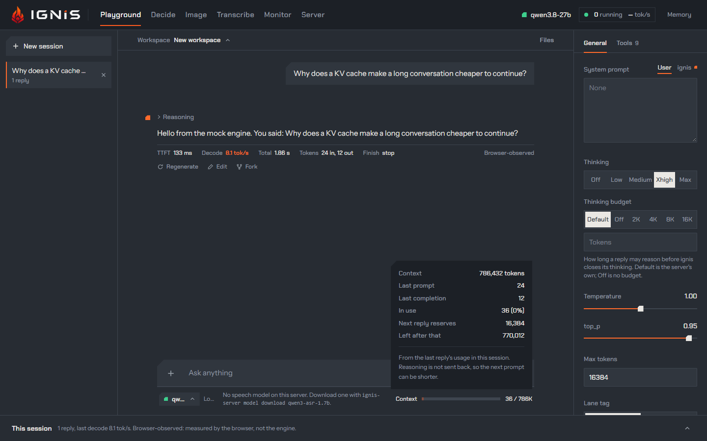
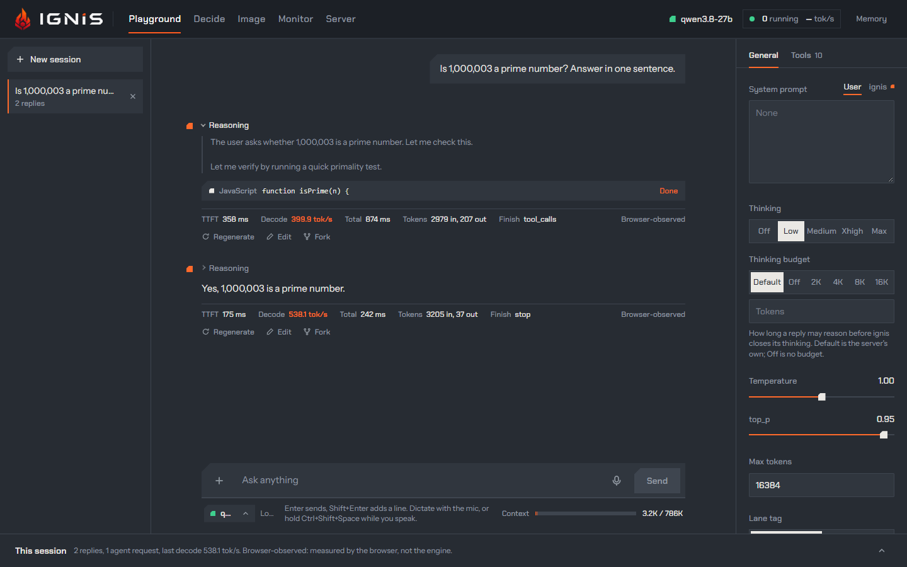
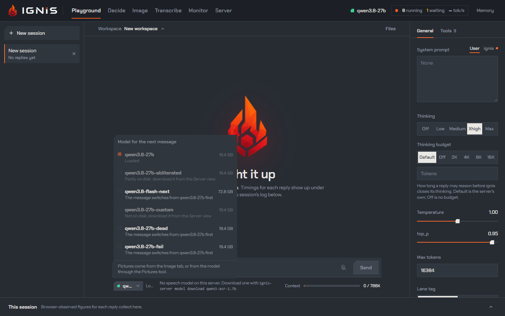
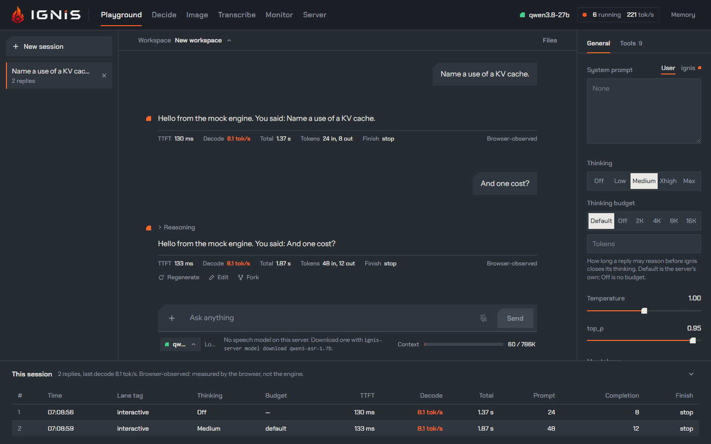

The **Playground** tab is a streaming chat with the loaded model. Sessions are
on the left ([Sessions](sessions.md)), the settings on the right
([Settings](settings.md)), the conversation in the middle under the bar that
names its [workspace](#the-chats-workspace), whose panel opens on the right,
and under all of them the session's log. Every reply shows what the model reasoned, what it called,
what it answered, and the figures the browser measured while it streamed.

## Sending a prompt

Type in the box at the foot: **Enter** sends, **Shift+Enter** starts a new
line. While the reply streams the button reads **Stop**, which ends the turn,
agents included. The **+** button adds to the prompt:

- **Image**: pictures sent with the prompt as `image_url` parts. The server
  must run with image input on ([vision](../configuration/vision.md)); the
  built-in `rtx5090` profile turns it on. A pasted image lands here too. Each
  thumbnail can be **marked**: circles or strokes drawn on it, so the model
  sees what you point at. While the **Workspace** switch is on, sending also
  makes each picture a file of the chat's workspace, as you picked it (or as
  you marked it), and names it in the prompt, so a later turn can read it
  again without your sending it twice.
- **File**: a text or PDF file for the chat's workspace. It waits in the box
  until you send, and **×** takes it out; sending adds it to the workspace and
  names it in the prompt. It is offered while the **Workspace** switch is on
  ([Tools and agents](tools-and-agents.md#workspace)).

An image or a file alone is a prompt. Nothing is sent until you press Send.

## The chat's workspace

A chat can have a **workspace**: files you and the model work on together,
kept in this browser and never on the server. It is born with the chat's
first file, a file you attach, make in the [panel](#the-workspace-panel) or
one the model writes, and takes the chat's title as its name; a chat that
makes no file has none, unless you pick an existing workspace for it
([the picker](#the-workspace-picker)). The chat stays in that workspace until
the workspace is deleted, a fork shares it, and deleting the chat keeps it.

A prompt that attached files lists them under its text, by the names they
took in the workspace: a name the workspace already holds gets a number,
`notes (2).txt`, and a pasted `image.png` sent twice is `image (2).png`. A
picture keeps its bytes once in this browser, by their SHA-256, in the store
the [Image view](image-studio.md)'s sessions use: the same picture in a
prompt, a workspace and an image session is one copy. The pictures the model
makes with `make_image` land in the workspace too, and its reply shows them
from there ([Pictures](tools-and-agents.md#pictures)). A file the model writes or edits shows in its reply as a card
with the version that call made; once a newer version exists, the card says
**Superseded by version 2** and **Open the latest** shows that one, and once
the newest version deletes the file it says **Deleted in version 3**: the
panel [restores it](#editing-by-hand-history-and-restore) from its history.
The model's side, its tools and the **Workspace** switch:
[Tools and agents](tools-and-agents.md#workspace).

A chat saved before workspaces shows as it did, its files from `create_file`
and the pictures `make_image` made in it included. The files it had attached
wait in the prompt box until its next turn, which makes them the first files
of its workspace.

### The workspace picker

The bar above the conversation names the chat's workspace. Before the chat
has one it reads **New workspace**, the default: a workspace born with the
chat's first file. Open it to pick one of the existing workspaces instead,
the last changed first; the chat works in that one from then on, with the
files it holds. To work in another workspace, start a new chat: **New
session** opens a new one rather than reuse an empty chat already given a
workspace.

Once the chat has a workspace, the picker shows its name and offers
**Rename** and **Delete workspace…**. A delete asks first, naming how many
files go. It removes the workspace, its files and every version, and frees
what nothing else uses: the bytes no other workspace holds, and the pictures
no chat, image session or other workspace names. It cannot be undone. The
chats that worked in it keep their messages, and their next file starts a new
workspace, as if they never had one. Deleting a chat never deletes its
workspace.

### The workspace panel

**Files** at the right end of the bar opens the panel of the workspace's
files, with their count beside it. On a screen 1,536 pixels wide or more the
panel is a column beside the conversation; on a narrower one it opens over
the right side, and **×** closes it. This browser remembers whether it is
open.

The files are a tree of their names: `site/css/main.css` sits in `site`, then
`css`, folders first and each level by name, with each file's size. A click
opens a file, with its kind, size and latest version, and when and by whom it
last changed: you, this chat, one of its agents, or another chat working in
the same workspace, by its title. **History** beside it holds the file's
versions ([below](#editing-by-hand-history-and-restore)).

- An HTML file opens in the same sandboxed preview as a reply's card, with
  its source, **Save as PDF** and the full-screen view; **Edit** beside it
  opens its text in the editor.
- Any other text file opens in the editor.
- A PDF shows the text the model reads of it.
- A picture shows at the panel's width with its size in pixels; a click
  opens it full screen.
- Any other file, an archive or a spreadsheet, shows its name and size: the
  model sees it in `list_files`, and `read_file` answers that it cannot read
  it.

What you do here is yours: each version it makes is authored by you.

- **New file** makes an empty text file under the name you type, `/` making
  folders; a name the workspace already holds gets a number, `notes (2).md`.
- **Upload**, or files dropped anywhere on the panel, adds files of any kind:
  text as text, a PDF with its text, a picture into the store pictures share,
  anything else as its bytes. A picture this browser cannot decode (HEIC in
  most browsers) is kept as bytes of a kind the model cannot read.
- On each file's row, the pencil renames it, the arrow downloads its latest
  version under the last part of its name, and the bin deletes it. A name
  another file holds, a deleted one included, is refused; a rename keeps the
  file's versions. A delete is a new version that marks the file deleted,
  with the versions before it kept.

With no workspace yet, the first file you make or upload here creates it,
named after the chat, or **Workspace** while the chat has no title. The panel
works with the **Workspace** switch off too: the switch takes the model's
tools away, never your files. When the browser refuses to store a change, the
panel says so in red, **Not saved in this browser:** and the reason; a refused
delete of a workspace is said in the bar.

### Editing by hand, history and restore

A text file opens in the editor, its text in a box. Typing changes the box
alone; **Save**, or **Ctrl+S** in the box (**Cmd+S** on a Mac), makes a new
version of the file, authored by you: one version per save. **Discard
changes** takes the newest version back. While you have typed nothing the box
follows the file, so a version the model writes meanwhile shows at once; once
you have typed, a newer version leaves your text alone and the editor names
it, and saving makes your text the newest version, the other kept in the
history. A file with CRLF line endings keeps them. What you type waits in the
box while you look at the file's other tabs; opening another file, **← All
files**, closing the panel, or a deletion of the file meanwhile, drops it.

The model reads your change before it changes the file again: its next
`write_file`, `edit_file` or `delete_file` of that file is refused until it
reads the file
([changes the model has not seen](tools-and-agents.md#changes-the-model-has-not-seen)).

**History** lists every version of the file, the newest first, with its time,
who made it and its size, or that it deleted the file. A rename changes no
content and makes no version: the history holds the file's versions under its
new name.

- **Compare two versions**, for a text file with two versions or more, picks
  any two of them (the two newest at first) and shows the lines the second
  removes, in red with `-`, and adds, in green with `+`, numbered in each
  version. Unchanged lines further than three lines from a change fold into a
  row that counts them. Two versions that differ by more than 1,000 lines
  removed and added show the lines between the start and the end they share
  removed whole, then added.
- **Restore**, on any version but the newest, makes a new version with that
  version's content, authored by you; the versions in between stay. A
  restore is undone by another one.

A deleted file leaves the tree. **Show deleted files**, beside **Upload** with
their count, puts them back in it, struck through: a click opens one on its
history, where **Restore** brings back a version from before its deletion. A
deleted file keeps its name meanwhile, so no other file takes it.

## Dictating a prompt

The **mic** beside Send dictates into the box, with the
[speech model](../api/transcriptions.md) on the server. Click it, or press
**Ctrl+Shift+Space** with the focus in the box: held for longer than 400 ms it
is push-to-talk, and letting go ends the dictation; tapped, it starts one, and
the next tap ends it. A silence ends it too, as described below.

While you speak:

- the mic becomes **Done**, and **Send** waits: a dictation is never sent by
  itself;
- a strip above the box shows a level meter, the words as they settle (light),
  the last few words the model may still change (grey), and a timer;
  **Listening…** before the first word;
- the box's underline runs.

**Done** ends it, and so does a silence: after 3 seconds without speech the
dictation stops by itself, exactly as if you had pressed Done. A shorter pause
cuts nothing. Push-to-talk never stops by itself: a held
Ctrl+Shift+Space ends when you let go. The silence is a
[setting](settings.md#dictation) in General: Off, 2 s, 3 s or 5 s, kept by
this browser; with Off, only Done, a second tap or letting go ends a dictation.

The strip reads **Finishing** while the server decodes the
last words; then the text lands at the cursor, selected, with a space added
where it would touch a word. Edit it as you like, and press Send when it is
ready. **Esc**, or **Discard** on the strip, throws the dictation away and
leaves the box as it was.

The line under the box follows along:

| When | It says |
|---|---|
| idle | Enter sends, Shift+Enter adds a line. Dictate with the mic, or hold Ctrl+Shift+Space while you speak. |
| listening | Listening. Done puts the text at the cursor; Esc discards it. |
| finishing | Finishing the last words. |
| for 6 s after | Inserted N words at the cursor. Nothing is sent until you press Send. |
| for 4 s after Esc | Dictation discarded. |
| every session taken | Speech is busy with another dictation. Trying again in N s. |
| refused again | The dictation still could not open: speech is busy. Press the mic to try again. |
| the server is up but the socket never opened | Dictation could not start: the server is up, but this address does not carry WebSockets. |
| the connection closed | Dictation stopped: the connection to the server closed. Insert what was heard, or discard it. |
| the server failed it | Dictation stopped: *the server's reason*. Insert what was heard, or discard it. |
| Done with no audio, or nothing said | Nothing was heard. |
| the server unreachable, the mic broken | Dictation could not start: *why*. |

**Busy.** The server holds `speech.max_sessions` (4) dictations at once
([speech](../configuration/speech.md)). One more is refused; the page counts
down the server's `Retry-After` (3 seconds when there is none, 15 at most) and
tries once more. A browser cannot read why a socket was refused, nor its
`Retry-After`, so the page asks the same route with a plain `GET`, which the
server answers as it would the upgrade and which it can read: `503 engine_full`
is busy, with the `Retry-After` the countdown starts from, `503 speech_unavailable` is the unavailable reason, and a server that
would have opened the socket says so, which means something between the page
and the server (a proxy that does not carry WebSockets) lost the upgrade.

**A stopped dictation.** If the connection closes, or the server fails the
dictation, the strip keeps what was heard (the settled words and the last grey
ones): **Insert what was heard** puts them at the cursor, **Discard** drops
them.

**One at a time.** The page dictates into one field at once. Pressing another
mic, in the [Image studio](image-studio.md) or [Decide](decide.md), ends the
dictation under way, and its text still lands in its own field. While the
[Transcribe](transcribe.md) view listens, every mic is struck and says
**Listening in Transcribe.**; a listening that starts ends the dictation under
way the same way.

### What a dictation sends

Each dictation is one session on the server's Realtime transcription route,
`GET /v1/realtime?intent=transcription`, opened at the press and closed when
the text lands. Pressing the mic is also what loads the speech model, if it is
not loaded. The session asks for:

- **the server's turn detection**: `turn_detection` is `{type: "server_vad",
  silence_duration_ms: <the setting>}`, the server's own defaults for the rest,
  and the server's first commit ends the dictation as Done does. With the
  setting Off, and for a held Ctrl+Shift+Space, it is **manual commit**
  (`turn_detection: null`) and **Done** commits;
- **16-bit PCM at 16 kHz**, the model's own rate: the browser downsamples the
  mic and sends 100 ms of audio at a time;
- **the provisional tail** (`session.ignis.provisional_tail: true`): the grey
  words;
- **a context**, as the transcription's `prompt`: the last reply, then what is
  already in the box, so names and terms are spelled the way the conversation
  spells them. The server reads its last `speech.context_max_tokens` (512)
  tokens.

No language is sent: the model detects it. The audio is never written to disk
or to a log.

### When the mic is struck through

A struck-through mic cannot start, and the line under the box says why:

| It says | Why | What to do |
|---|---|---|
| The microphone needs https or localhost. … | The browser gives a page a microphone only over https or on localhost. | Open the Playground through an https proxy, or start the server with `--server-expose cloudflare-quick` ([access](../configuration/access.md)). |
| No speech model on this server. Download one with `ignis-server model download <id>`. | The speech model's files are not on disk. | Run that command ([fetching a model](../guides/models.md#fetching-one-ignis-server-model-download)). |
| Speech is turned off on this server (`speech.model = off`). | The server was started with the speech model off. | Set `--speech-model auto` ([speech](../configuration/speech.md)). |
| Microphone access is blocked for this site. … | You, or the browser, refused the microphone. | Allow it in the browser's site settings, then press the mic again: this one stays pressable. |
| Speech is unavailable on this machine: the CPU lacks AVX2 … | The speech model runs on a CPU with AVX2. | — |

The server's reasons come from `GET /v1/models`' `speech` object, read when
the page opens and with each message; a reason the table has no row for is
shown in the server's own words.

## What a request carries

On a real server the chat talks over **one WebSocket** to `/v1/responses`
([the Responses API](../api/responses.md)): every session and every agent
shares it, and a turn sends only the items that are new since the last one.
Choose **HTTP** under Settings, or let the page fall back to it when the socket
does not open, and each turn is a `POST /v1/chat/completions`; then the browser
carries at most five streams at once, agents included. When the page falls
back, a bar under the header says so once.

A request never names a `model`: the chat follows the model the server has
loaded, so it cannot start a switch by accident (the
[two names pitfall](../concepts/switching-and-idle-unload.md)). It carries
the settings (`reasoning_effort`, `thinking_budget`, `temperature`, `top_p`,
`max_tokens` or `max_output_tokens`, and `class`, the lane tag), the tools
that are on, and the system prompt, which stays the same from turn to turn.
What the page tells the model about a turn, the titles of the memory notes
and the moment, goes ahead of the prompt as its
[turn notice](tools-and-agents.md#the-turn-notice).

## A reply

From top to bottom:

1. **Reasoning**, folded under its summary once the reply ends (it reads
   **Thinking…** and stays open while it streams). An orange **Budget reached**
   mark says the [thinking budget](settings.md#thinking-and-its-budget) closed
   it. Reasoning the [loop guard](../concepts/reasoning.md) took back is shown
   struck through, where the loop was.
2. **Queued**, over the WebSocket only, when every lane was busy and the
   server held the request in its queue instead of refusing it.
3. **The answer**, as Markdown: headings, lists, tables, code blocks with a
   **Copy** button, formulas (KaTeX: `$…$`, `$$…$$`, `\(…\)`, `\[…\]`), and a
   **Preview** of an `html` block. **Markdown in replies** off shows the raw
   text.
4. **Tool sections**: Agents, Web, Tool calls, Pictures, Questions
   ([Tools and agents](tools-and-agents.md)).
5. An **error line** for a request the server refused, with its status and
   message, such as `503: … engine full` over HTTP.
6. **The figures line**.
7. **Regenerate**, **Edit** and **Fork**: regenerate drops this reply and what
   follows and asks again; edit changes the text in place; fork starts a new
   session from here. A prompt has **Edit** too, with **Save and resend**.

## The figures line

| Figure | What it measures |
|---|---|
| **Queued** | How long the request waited for a lane (only when it did). |
| **TTFT** | Send to the first token of any kind: reasoning, answer or tool call, less the queue. |
| **Decode** | Tokens per second from the first token to the last: `(completion tokens − 1) / (last − first)`. |
| **Total** | Send to the end of the stream. |
| **Tokens** | Prompt and completion tokens, from the stream's final `usage`. |
| **Rewound** | Tokens the loop guard took back (`rewound_tokens` in `usage`), when it did. |
| **Finish** | The `finish_reason`, or `stopped`. |

They are **browser-observed**: measured around the stream, over the network,
not inside the engine. A decode rate here includes the network and the page;
the server's own figures are in the [Monitor](monitor.md) and its
[metrics](../reference/metrics.md).

## The model picker

Under the box, the picker names the model the **next message** goes to, and a
chip beside it says what sending will do first: **Loaded**, **Loads when you
send** (after an idle unload), or **Switches from … when you send**. The menu
lists the text models the server knows, with their size and whether a message
can go to them; one that is not on disk points at the Server view, where it is
downloaded.

Choosing another model makes the next message switch the server
(`POST /v1/models/switch`), wait for the load and then send; the prompt says
`Switching to … from …` while it does. The choice holds for that message only:
the chat then follows the server again. With the image model loaded, the next
message goes back to a text model on its own. How switching works and what it
costs: [Models that come and go](../why-ignis/models-that-come-and-go.md).

## The context meter

**Context** shows how much of the model's context the session uses: the solid
part is the last reply's prompt plus completion, the pale part the room the
next reply reserves (its Max tokens). Hover it for the numbers: the context,
the last prompt, the last completion, what is in use, what the next reply
reserves and what is left after that. The limit is the loaded model's
`max_model_len` from `GET /v1/models`. Reasoning is not sent back on the next
turn, so the next prompt can be shorter than the meter suggests. Over the
limit the bar turns red: the server would refuse the request, so lower Max
tokens or start a new session.

## The session log

**This session**, at the foot, collects a row per request: the time, the lane
tag (agents show as `agent <name>`), the thinking effort and budget (with
`reached` when the budget closed the reasoning), TTFT, decode rate, total,
prompt and completion tokens, and the finish reason. A failed request shows its
error across the row. It is the quickest way to compare two settings on the
same prompt.

## When the model is not serving

The empty chat says what the server is doing: **Light it up** when a model
serves, **Warming up** while one loads, **Switching models** during a switch,
and that a model unloaded while idle loads again with the next message. While
no model can take a message the prompt box reads `Waiting for the model…` and
Send is off.

## Read more

- [Settings](settings.md): thinking, the budget, sampling, the lane tag, the transport.
- [Reasoning that finishes](../why-ignis/reasoning-that-finishes.md): the loop guard and the budget behind the marks above.
- [Chat completions](../api/chat-completions.md) and [Responses](../api/responses.md): the same requests from your own code.
- [Speech to text](../api/transcriptions.md) and [the speech settings](../configuration/speech.md): the model behind the mic.
