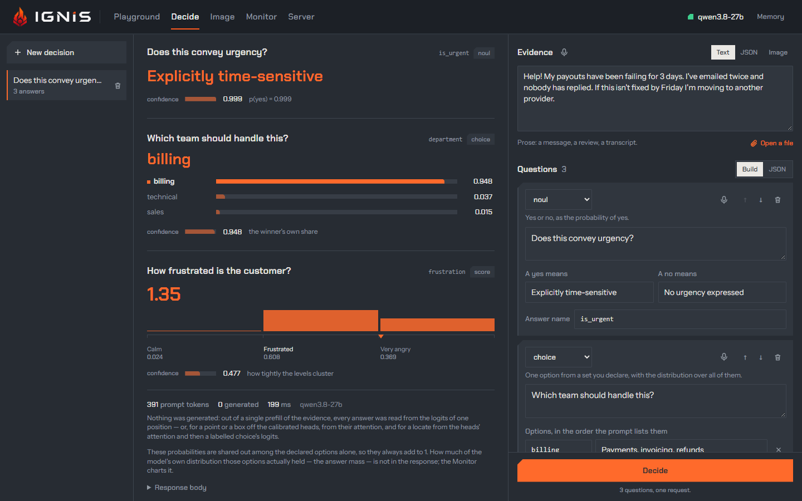
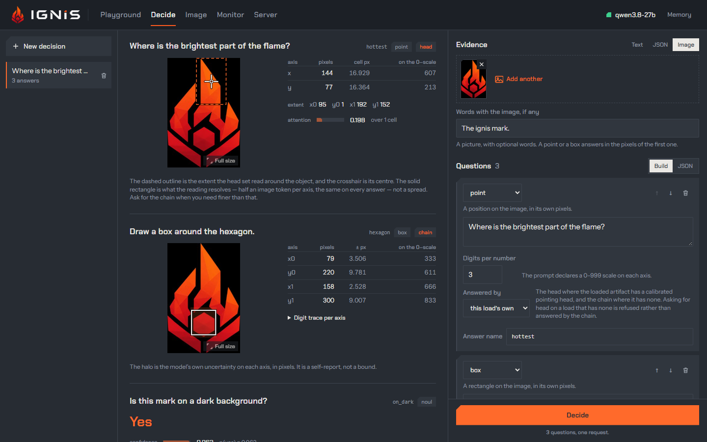
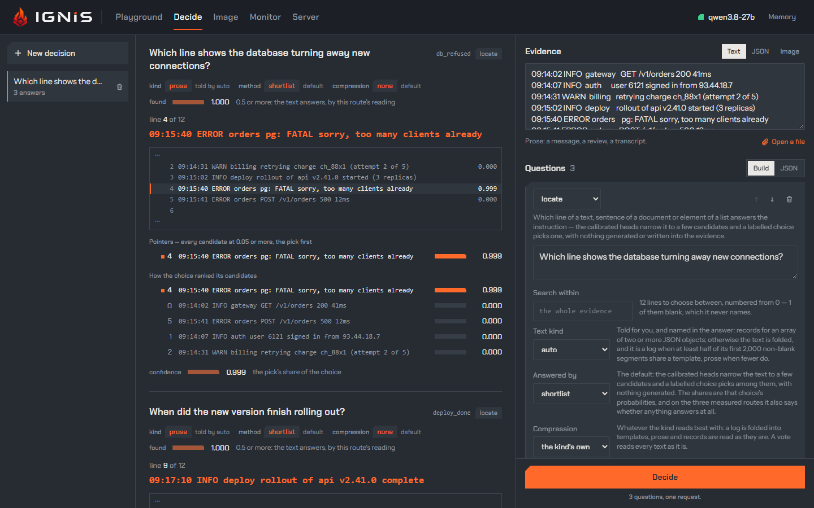

**Decide** builds a request for [`POST /v1/decide`](../api/decide.md), sends
it, and draws what comes back. A decision is one piece of **evidence** (text,
a JSON record or an image) and any number of **questions** over it. The server
prefills the evidence once and reads each answer straight off the model's
distribution: a yes/no, a choice or a score generates no token at all, so
twenty questions cost about what one costs, and every answer comes with the
probability of each option instead of a sentence to parse.

The view has three columns: **Decisions** on the left (kept in this browser,
like the chat's sessions), the **answers** in the middle, and the **bench** on
the right, where the evidence and the questions are written.

## Start from an example, or from your file

The opening screen offers your own file (a log, a document or a JSON file,
chosen or dropped anywhere on the tab) and nine examples. An example fills the
bench and sends nothing:

| Example | Shows |
|---|---|
| Triage one message | three questions over one message: a yes/no, a choice of department, a frustration score |
| Route to one of twelve | a wide choice whose distribution stays readable |
| Ask the Three Laws | eight dilemmas, each option an action and the law that would justify it |
| Read a structured record | evidence as JSON, not prose |
| Count something | a number, generated a digit at a time, each digit with its confidence |
| Ask without a width | a scalar that closes itself: `2.5`, `-0.75` |
| Find the line in a log | `locate`: which line of a log answers a question, read off attention heads |
| Pick one from a list | `locate` within part of a JSON state |
| Find it on an image | a point and a box in the pixels of the picture |

## The evidence

**Text**, **JSON** or **Image**: switching keeps what each shape held. A file
loaded from disk shows as a card with its line count, a strip of the whole
file with errors and warnings tinted, and how it begins and ends; a JSON file
becomes a record, anything else text. Loading a file into an empty decision
adds a `locate` question for it. An image can carry words beside it; a point
or a box answers in the pixels of the first image.

## The questions

Each card is one question: its **type**, what the model should decide, the
type's own fields, and the **answer name** it comes back under.

| Type | Answers | Generated tokens |
|---|---|---|
| `noul` | yes or no, as the probability of yes | none |
| `choice` | one of the options you declare, with the distribution over all of them | none |
| `score` | a value across ordered levels: the weighted average, so it can land between two | none |
| `number` | a whole number, a digit at a time, each digit with its probability | one per digit |
| `scalar` | a number that ends when it is complete, fractional or negative | one per character |
| `point` | a position on the image, in its own pixels | one per digit, or none off the calibrated heads |
| `box` | a rectangle on the image | one per digit, or none off the calibrated heads |
| `locate` | which line, sentence or list element answers the instruction | none |

The order of a choice's options is part of the prompt, and kept as written.
**JSON** switches the bench to the request body itself, for anything the
builder does not cover; it is exactly what **Decide** sends.

## Dictating a question or the evidence

Each prose field has a mic of its own: a question's card on its top row
(**Dictate into Question**), a **Text** evidence beside its heading
(**Dictate into Evidence**). It works as the
[chat's mic](chat.md#dictating-a-prompt) does, Ctrl+Shift+Space included, in
the field it belongs to: the field keeps an ember border while you speak, the
strip sits under it, the text lands at its cursor, and nothing is sent until
you press **Decide**. A JSON evidence, a file loaded as the evidence and the
**JSON** request body have no mic: speech is for prose.

The context a dictation sends is the other prose on the bench first and the
field's own text last: the questions, then the evidence, for the evidence; the
evidence, then the question, for a question. JSON never goes in, nor an
evidence loaded from a file. Pressing another field's mic ends the dictation
under way: it is committed, and its text lands in its own field when it
comes, while the new field listens.

## The answers

**Decide** sends one request; the footer says `N questions, one request`.
Answers come back in the request's order:

- a **yes/no** shows the winning word, its confidence and `p(yes)`;
- a **choice** shows the winner and a bar per option with its probability;
- a **score** shows the value on a bar chart over its levels;
- a **number** or **scalar** shows the value with its spread and a **digit trace**: the probability of each digit the model wrote;
- a **point** or **box** is drawn on the picture with its uncertainty, beside a table in pixels;
- a **locate** shows the line it picked, the lines around it, how the candidates ranked, and a strip of the whole text with the pick marked.

Under them: the prompt tokens, the tokens generated (zero when every answer
is a readout), the time the browser measured, and the model. **Response body**
opens the raw JSON. These probabilities are shared among the declared options
alone, so they always add to 1; how much of the model's own distribution the
options held, the **answer mass**, is in the [Monitor](monitor.md) and the
metric `ignis_decision_answer_mass`.

## Read more

- [Decisions without decoding](../why-ignis/decisions.md): how it works and what was measured.
- [`/v1/decide`](../api/decide.md): the request and the response, field by field.
