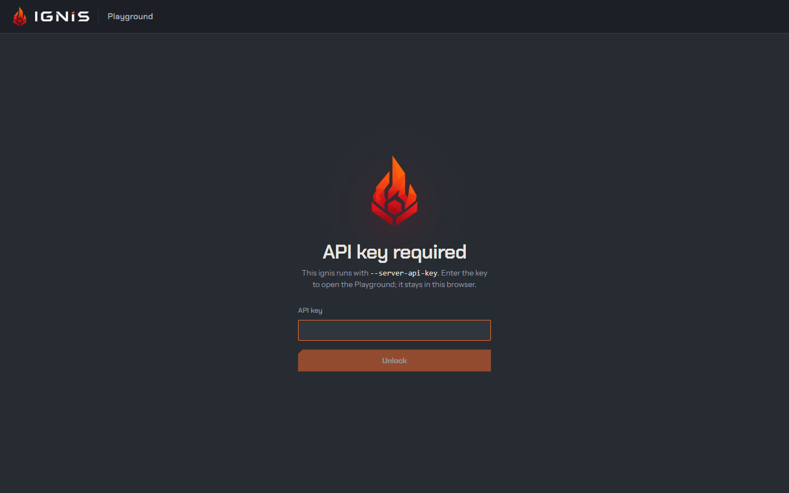

The Playground is a web app built into `ignis-server` and served at
**`/ui/`**, on the same port as the API: open <http://127.0.0.1:8000/ui/>
once the server is up. It is the quickest way to see what ignis does, and it
is built to show its work: every reply carries the figures the browser
measured, subagents run on their own lanes in front of you, a decision shows
the whole distribution behind its answer, and the Monitor draws the server's
own metrics as they move.


Nothing in it is a private API. Every view talks to the same `/v1` routes a
client of yours would, so each page of this section names the request a
control sends: what you click in the Playground is what you can script.

## The views

The header switches between six views. The chat stays mounted under the
others, so a reply keeps streaming while you look at the Monitor, and a
listening in Transcribe goes on whichever view shows.

| View | What it is for | What it asks the server | Page |
|---|---|---|---|
| **Playground** | Chat with the model: reasoning, tools, subagents, images and files in the prompt, several sessions | `/v1/responses` over a WebSocket, or `/v1/chat/completions` | [Chat](chat.md), [Settings](settings.md), [Tools and agents](tools-and-agents.md), [Sessions](sessions.md) |
| **Decide** | Ask many questions over one piece of evidence, answered from one prefill with nothing generated | `POST /v1/decide` | [Decide](decide.md) |
| **Image** | Make and edit pictures with the image model, step by step | `/v1/images/generations`, `/v1/images/edits` | [Image studio](image-studio.md) |
| **Transcribe** | Write a conversation down, from the microphone, a call or a file, with its speakers | `/v1/realtime?intent=transcription` over a WebSocket | [Transcribe](transcribe.md) |
| **Monitor** | The server's Prometheus metrics, drawn live: load, latency, the VRAM plan, reuse, speculation | `GET /ui/metrics` | [Monitor](monitor.md) |
| **Server** | The loaded model, the models a switch can go to, and the running configuration as a form | `/v1/models`, `/v1/models/switch`, `/v1/config` | [Server](server.md) |

The Monitor tab appears only while the server serves metrics (`server.metrics`,
on by default). Below 640 px wide the tabs become one menu, and below 1024 px
the side columns of the chat, Decide, Image and Transcribe views open as
drawers from the header.

## The header

Left to right: the flame, which burns while a reply streams or a model loads;
the view tabs; the **model status** (the model's id with a green square when
it serves, `Loading…` or `Switching to…` while it does not, `· unloaded` in
grey after an [idle unload](../api/idle-unload.md)); in the chat, a chip with
how many requests are running and the server's token rate, which opens the
Monitor; while a [Transcribe](transcribe.md) listening is under way, its
state and time, which open that view; **Memory**, the notes the model keeps about you
([Tools and agents](tools-and-agents.md#memory)); and **Lock** while an API key
is stored.

## An API key

When the server runs with a key ([access](../configuration/access.md)), the
first `/v1` request answers 401 and the page asks for it. The key is checked
with `GET /v1/models`, kept in this browser (`localStorage`), and sent on every
request as `Authorization: Bearer`; the WebSocket offers it as a subprotocol.
**Lock** forgets it.



## What the page keeps

The chat's sessions, the Decide tab's decisions, the Image view's sessions
and pictures and the Transcribe view's transcripts are stored in this browser (IndexedDB) and come back after a
reload; nothing is stored on the server. Settings are not stored, apart from
the three marked *stored* in [Settings](settings.md): a reload puts the
defaults back. The details, and what each key holds:
[Sessions and storage](sessions.md).

## Turning it off, building it in

`--server-ui false` (config `server.ui`) stops serving it. The Playground is
embedded into `ignis-server` only if `web/dist` exists when cargo builds it;
cargo never runs npm. The release archives and the container image have it.
From a checkout, build the frontend first (it needs Node.js), then the server:

```
npm --prefix web ci
npm --prefix web run build
cargo build --release -p ignis-server
```

A server built without `web/dist` still serves `/ui/`, as a page with these
instructions.

For frontend work, `npm --prefix web run dev` serves the page with hot reload
and proxies `/v1` and `/ui/metrics` to a running server (`IGNIS_URL`, default
`http://127.0.0.1:8000`). `npm --prefix web run dev:mock` answers from a fake
engine instead, so no GPU is needed; it has no WebSocket, no image routes and
no idle unload, and its replies are canned.

## Where to go next

- [Chat](chat.md): a reply, its figures, the model picker, the context meter.
- [Tools and agents](tools-and-agents.md): subagents on agent lanes, the web, code, files, pictures.
- [Why ignis](../why-ignis/index.mdx): the engine features these views make visible.
