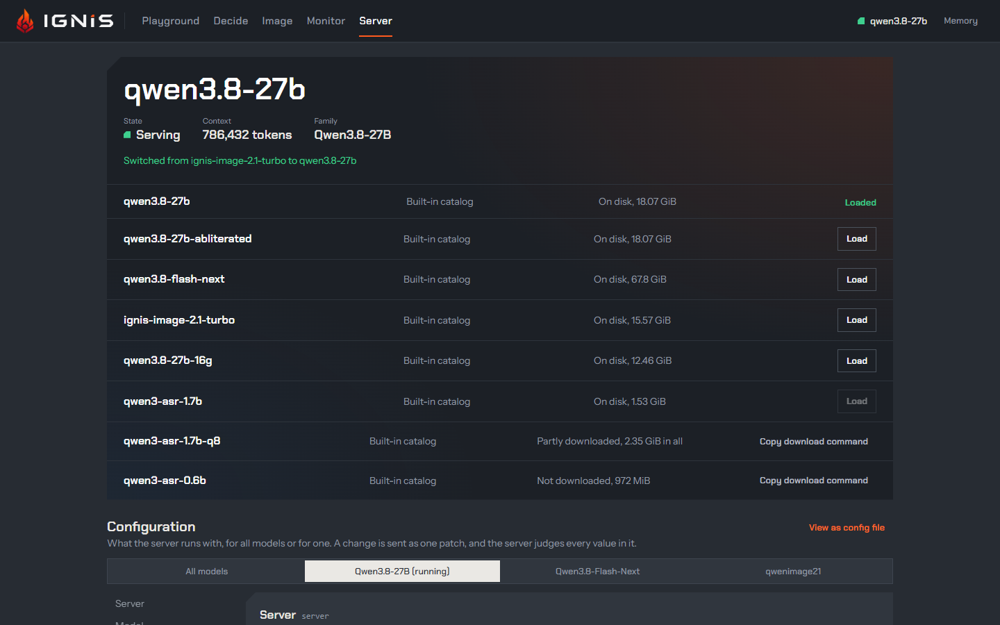
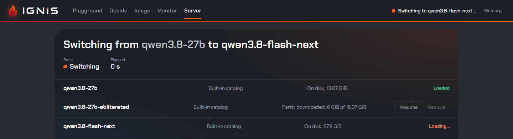
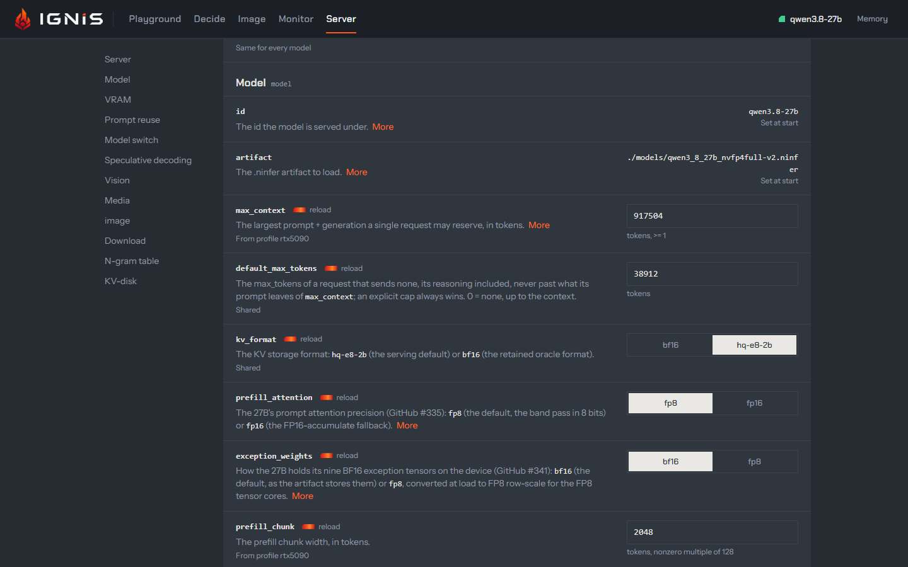

The **Server** view changes the running server from the page. At the top, the
**model band**: what is loaded, its state and context, and every model the
server knows. Below it, the **configuration**: every field the server runs
with, as a form. Applying a change sends one `PATCH /v1/config`; the server
judges every value, applies what it can live, and reloads the model only for
a field that needs it.

## The model band

The headline is the loaded model's id with its **State** (`Serving`,
`Switching`, `Loading`, `Unloaded`, `Not serving`), its **Context** in tokens
and its **Family**. Under it, one row per model the server's catalog knows
(`GET /v1/models/catalog`): where the entry comes from (the built-in catalog,
an [operator catalog](../guides/operator-catalog.md), or a known model), how
much of it is on disk, and one action:

- **Loaded** for the model that serves;
- **Load** for one on disk: it switches to it by id (`POST /v1/models/switch`),
  whatever `switch.allow_implicit` says;
- **Download** for a catalog entry not on disk: the server downloads it
  ([Downloading a model](#downloading-a-model));
- **Resume** for one partly downloaded, a cancelled download's included: the
  server downloads the rest ([Cancelling and resuming](#cancelling-and-resuming));
- **Cancel** while its download runs: it stops it, keeping what it fetched;
- **Not for this card** for an entry above the card's class
  ([the catalog](../guides/models.md#the-catalog)), with the server's reason as
  its tooltip: neither loaded nor downloaded;
- **Copy download command** in place of **Download** or **Resume** when the server does not
  download from the page (`download.enabled` or `download.from_ui` false): it
  copies `ignis-server model download <id>`.

During a switch the band says what is happening and for how long; afterwards
it keeps the outcome: `Switched from … to …`, or why the switch was refused
or failed and which model serves now. A model the server
[unloaded while idle](../api/idle-unload.md) shows as **Unloaded**, not as an
error; the next message loads it again, and **Load** does it now. While a chat
reply streams, the band says how long a switch would let it finish
(`switch.drain_timeout`) before cancelling it.

## Downloading a model

**Download** sends `POST /v1/models/download` with the entry's id, and the
server fetches it into its own `download.path`, whatever machine the browser
runs on, with the same transfer as `ignis-server model download`: each file
resumed from its `.part`, checked against its pinned size and SHA-256
([Get a model](../guides/models.md#downloading-from-the-server-view-post-v1modelsdownload)).
It runs in the background while the loaded model keeps serving. The row then
reads `Downloading, <on disk> of <total>, <speed>/s`: the page reads
`GET /v1/models/catalog` every second while a download runs, and the speed is
the bytes landed between those reads. One download runs at a time, so every
other **Download** and **Resume** is out of reach until it ends; so is every one during a
switch, or while no model serves.

Once every file verified, the row reads `On disk` and offers **Load**: the
server never switches to a model by itself. A partly downloaded entry offers
**Resume** instead. A download that fails keeps its reason under the row,
`Download failed: …`, until the entry's next download or a restart; a gated
repository fails naming the token the server reads from its environment
(`IGNIS_DOWNLOAD_TOKEN`, or `HF_TOKEN` for huggingface.co). The page never asks
for a token nor shows one. A refused **Download** (another one running, the
entry already on disk, downloading turned off) shows the server's reason in the
band.

Before a byte is written, the server checks that the volume of its
`download.path` has room for the entry's bytes still missing plus
`download.free_margin` (`1G` by default). Short of room, **Download** is
refused, and the reason, naming the bytes needed and the bytes free, shows under
the row rather than in the band, `Download failed: not enough room for …`,
until the entry's next download or a restart
([Room on the disk](../guides/models.md#room-on-the-disk---download-free-margin)).
Free some space there and press **Download** again. `download.free_margin` is
shown read-only, `Set at start`, in the Download group.

Downloading takes the same API key as **Apply**
([ADR 0071](../../adr/0071-the-server-downloads-and-removes-models-from-the-server-view.md)).
`download.from_ui` false turns it off for the page and the API, and
`download.enabled` false keeps the server off the network altogether; both are
shown read-only, `Set at start`, in the Download group.

### Cancelling and resuming

**Cancel** on the running row sends `POST /v1/models/download/cancel`, and the
server stops the download before it answers: the files it verified stay at
their names, and the file it was writing stays as its `.part`, with every byte
that arrived. The row then reads `Partly downloaded, <on disk> of <total>` and
offers **Resume**, which sends `POST /v1/models/download` again: the server
fetches only what is missing, from the `.part` on, and checks each file against
its pinned size and SHA-256 before it renames it into place, as for any
download ([Get a model](../guides/models.md#cancelling-and-resuming-post-v1modelsdownloadcancel)).
**Cancel** is out of reach while it is being sent, during a switch, or while
no model serves, and takes the same API key as **Download**.

A download cut short by a dropped connection or a restart of the server leaves
a partial entry too, shown the same way. Nothing resumes by itself: after a
restart the entry stays partial until **Resume**, or `ignis-server model
download <id>` on the server's machine, continues it. The one exception is the
model the server is started to serve, which a start fetches when it is missing,
as before ([Letting the server fetch it](../guides/models.md#letting-the-server-fetch-it)).

## The configuration

**Scope** picks what the form edits: **All models** (the shared values) or one
model family (its own values, which win over the shared ones). The groups
(Server, Model, VRAM, Prompt reuse, Model switch, Speculative decoding,
Vision, Media, image, Download, N-gram table, KV-disk) are listed on the left;
an orange count marks the groups holding a change.

Each row is one field ([every field](../reference/configuration.md)): its
name, the first sentence of its description (**More** for the rest), and
where its value comes from: `From profile rtx5090`, `Set by
IGNIS_MODEL_THINKING_BUDGET` (a flag or an environment variable), `Shared`,
or `Own value`. A **reload** mark says a change to it reloads the model. A
field set only at start (the bind address, the API key, the artifact) is shown
read-only, `Set at start`.

Editing fills a draft and sends nothing. The dock at the foot counts the
changes and offers **Discard** and **Apply**, which reads **Apply and reload
&lt;model&gt;** when the draft holds a field that reloads it. The label is the
confirmation; there is no dialog.

- A live change answers at once: `Applied and written to <path>`, the config
  file in use, or why it was not written. A value a flag or an environment
  variable would override at the next start is named.
- A reload is followed in the model band, then `Reloaded <model> and written
  to <path>`.
- A refused value is named by the server; its row is marked `Refused by the
  server`, and nothing was applied.

**View as config file** shows the configuration in force, live changes
included, as `ignis.yaml`, to copy or download.

## Read more

- [Configuration](../configuration/index.md): fields, precedence and profiles.
- [Models that come and go](../why-ignis/models-that-come-and-go.md): what a switch does and costs.
- [Model switching](../api/model-switching.md): the same switch from your own code.
