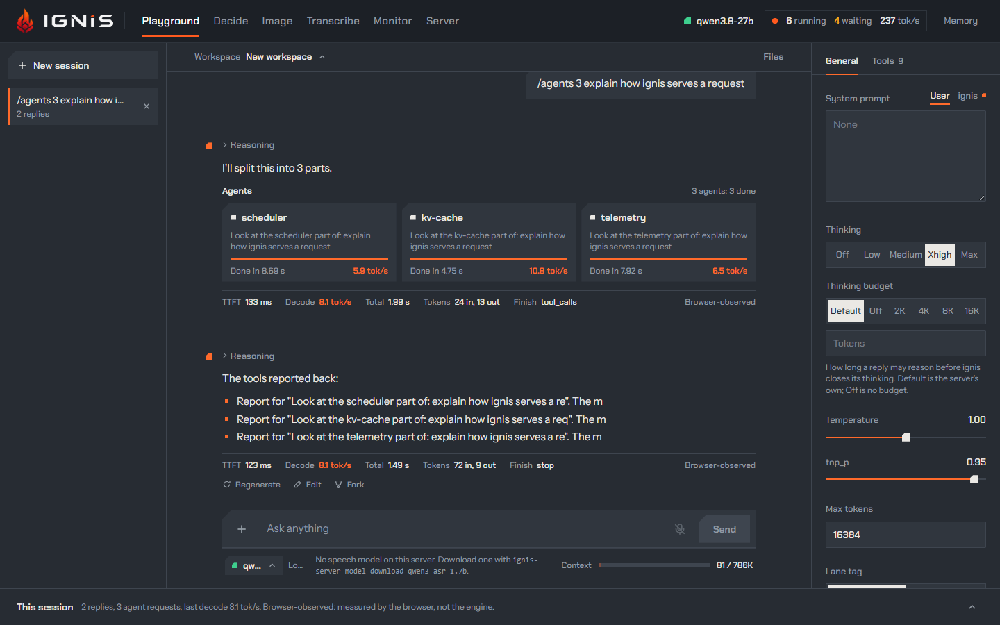
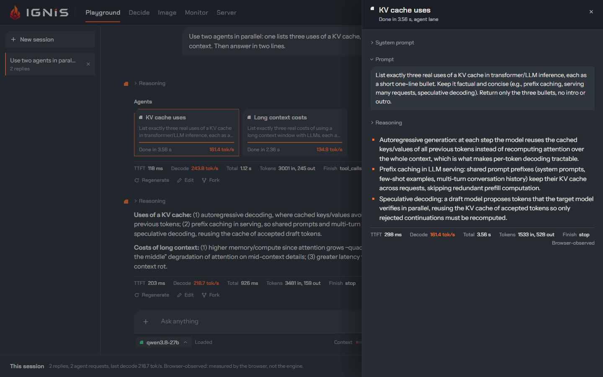
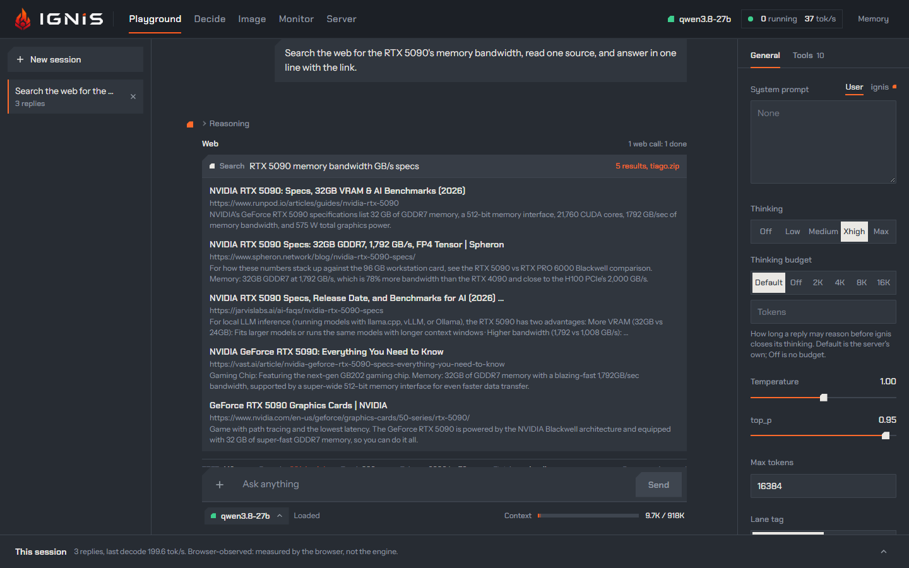
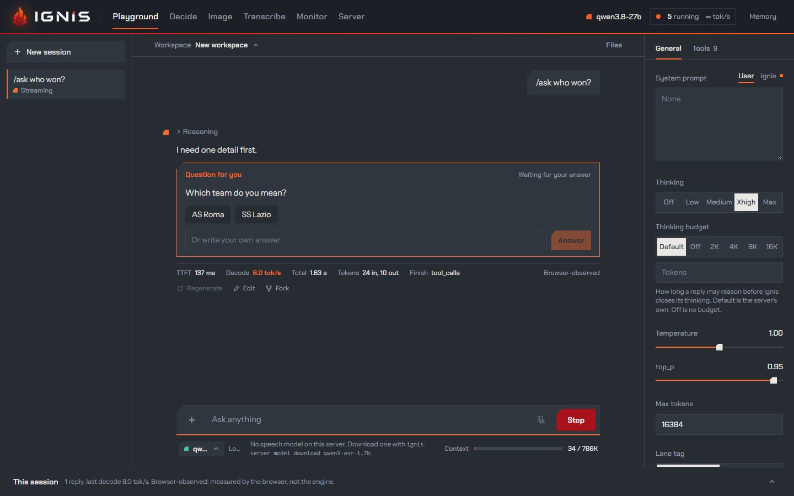
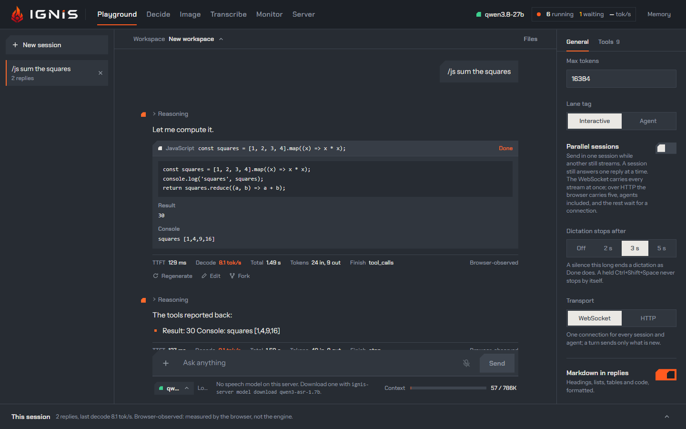
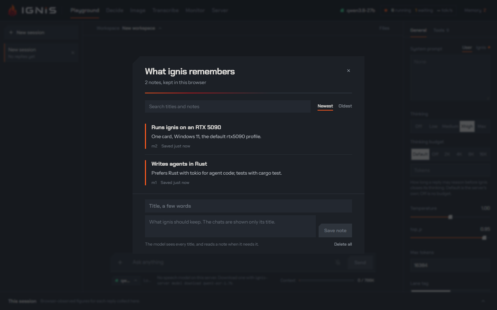
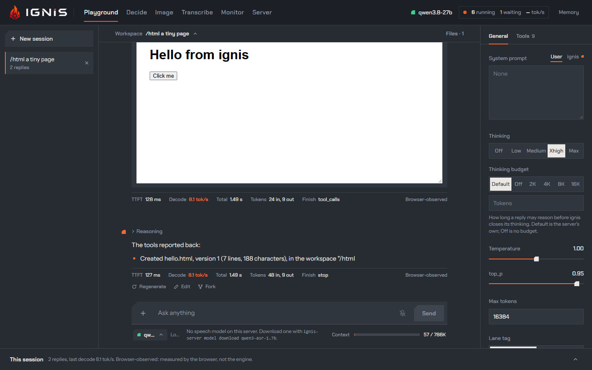

The chat gives the model nine tools, all on by default
([Settings](settings.md#tools)). The tools run **in the browser**: the server
only sees the model decide to call one and, on the next request, the result.
That makes the Playground an agent loop you can watch: a turn streams a reply,
runs the calls it made, sends the results back, and goes on until a reply
calls nothing, up to **Tool rounds** replies. A call to a tool the model was
not given is shown under **Unknown tools** with its arguments, and not run.

## Agents

With **Agents** on, the model can hand sub-tasks to subagents. Each one is its
own request, on an **agent lane** (`class: "agent"`), and up to eight run in
parallel on the server's decode lanes, while the conversation keeps its own.
The answers go back to the model, which writes the final reply. Agents get the
other tools that are on, except asking you, the plan and pictures.

The **Agents** section shows a card per agent: its name, its task, a heat bar
while it runs, then `Done in <time>` and its decode rate. Click a card to open
the **agent reader**: its system prompt, its task, its reasoning, the tools it
called, its answer and its own figures. The session log gets a row per agent
request, tagged `agent <name>`.

This is the load ignis is built for: one main conversation and a burst of
subagents on one card. Why the burst does not push the conversation out:
[Lanes that know who is asking](../why-ignis/lanes.md) and
[One round for every lane](../why-ignis/decode-round.md).

## Web

**Web** lets the model search (five results) and read pages (the first 20,000
characters). The calls run from your browser, not from the server: with a
Tavily API key (typed under the Web switch, kept in this browser and sent only
to Tavily) searches go to Tavily; without one they go to `search.tiago.zip`,
then to DuckDuckGo Lite through `r.jina.ai`, and pages are read through
`r.jina.ai`. ignis takes no part. Each call is a row under **Web** you can
open: the results with their links, or a preview of the page.

:::caution[Your queries leave the machine]
A web search sends the model's query to the search service from this browser.
Turn **Web** off for a conversation that must stay on the machine.
:::

## Ask me

**Ask me** lets the model stop and ask you something, with answers to pick or
your own. The turn waits under **Questions** until you answer, then goes on.
Only the conversation asks; agents do not.

## Date and time

**Date and time** writes the day, date, time and time zone into the ignis
system prompt once per session. It is frozen on purpose: a prompt that changes
every turn could not be reused from the server's cache. **Update every
prompt** sends the moment of each turn in its [turn notice](#the-turn-notice),
after the conversation, instead.

## Run JavaScript

**Run JavaScript** gives the model a sandbox for exact results: a Web Worker
with no network, no page and no storage, a 10 s limit and 10,000 characters of
output. With **Safety check** on (the default), a request on an agent lane
reviews each piece of code first, greedy and without thinking, and code it
does not call safe is blocked. A row under **Tool calls** shows the code, the
check's verdict, the result and the console.

## Plan

**Plan** lets the model keep a checklist of its steps in the reply, updated as
it works: done, in progress, pending.

## Memory

**Memory** lets the model save short notes about you in this browser, each a
title and a body, shared by every chat. The model sees the titles in the
[turn notice](#the-turn-notice): every one at a chat's first prompt, and later
only the notes you or another chat saved, changed or deleted since. It reads a
note's body with `memory_read` when it needs it. **Memory** in the header opens
the notes: search them, edit them, delete them, or write one yourself. They
live in this browser's `localStorage`, never on the server.

## The turn notice

The ignis system prompt and the tools block are the same in every chat,
whatever the memory and the workspace hold, so the server reuses a conversation's prefix
instead of prefilling it again ([when reuse
misses](../concepts/kv-cache-and-prompt-reuse.md#when-reuse-misses)). What
changes from turn to turn rides in the **turn notice** instead: a developer
message the page puts right before your prompt, after the conversation so far
([ADR 0072](../../adr/0072-the-playgrounds-system-prompt-never-changes.md)).

- At a chat's first prompt it lists the titles of the memory notes, newest
  kept first up to 4,000 characters, with a line counting the older ones left
  out.
- At a later prompt it lists only the notes saved, changed or deleted since
  the last notice by someone other than this chat: you, from **Memory** in the
  header, or another chat. What this chat's own `memory_save` and `memory_delete` calls
  did, its agents' included, is not repeated to it.
- With **Update every prompt** on, it carries the [moment](#date-and-time)
  too, ahead of the notes.
- A prompt with nothing to tell carries no notice.

A notice is kept with its prompt, in the chat and across a reload, and every
later request sends it again byte for byte; a chat saved before the notice
sends the moments its prompts carry as it always did. An agent gets every
title in a notice ahead of its task. A server whose
`--server-developer-message-policy` joins or gathers developer messages
(`into-system`, `after-system`, `one-after-system`,
[prompting](../configuration/prompting.md)) loses the reuse for it, as it does
for the moment.

## Workspace

**Workspace** lets the model work on the files of the
[chat's workspace](chat.md#the-chats-workspace), with five tools, declared
whenever the switch is on, whether the chat has a file yet or not:

- `list_files`: each file's name, kind (text, PDF, picture, audio or other),
  size, last change and who made it: you, the chat itself, one of its agents,
  or another chat.
- `read_file`: a text file as numbered lines, a range at a time (`offset` is
  the first line, `limit` the most lines), up to 20,000 characters a call; a
  PDF reads as its text, and an audio file as its transcript, the same way.
  A PDF's text and a transcript are computed on the first read of a version
  and kept with it; a transcript comes from the server's speech model, and
  without one the call answers why
  ([audio in the workspace](chat.md#audio-in-the-workspace)), the model
  still free to delete the file. A picture comes back as the picture itself
  when the loaded model has vision ([below](#pictures-the-model-reads)). A
  file of a kind it cannot read answers with its kind and size.
- `write_file`: creates a text file or replaces it whole. A name may hold `/`
  for folders, as in `site/index.html`, and is unique in its workspace.
- `edit_file`: replaces one passage of a text file (`old`) with another
  (`new`), so that a small change to a large file costs little. The passage
  must occur exactly once: one that occurs nowhere, or several times, is
  refused, and the refusal says which, with the lines where it occurs.
- `delete_file`: deletes a file. It leaves the workspace's list, and its
  history keeps it.

Every write, edit and deletion is a new version of the file, with its author
and time; the earlier versions are kept, and a deletion is a version that
marks the file deleted. The model's first file creates the workspace. Agents
get the same five tools, each as a reader of its own
([below](#changes-the-model-has-not-seen)). A file you attach with **File** in
the prompt box becomes a file of the workspace when the prompt is sent, and
the prompt says so after your words: `[Attached to the workspace: brief.pdf]`.
A picture you attach or paste goes with the prompt as it always did and
becomes a file of the workspace too, named the same way. You see the files,
and add, rename, delete and download them, in the
[workspace panel](chat.md#the-workspace-panel).

A file the model writes or edits shows in its reply as a card: its name, the
version that call made, its size, **Preview** and **Download**; a deletion is
a row naming the file. An HTML file opens on a live preview in a sandboxed
frame (scripts run, no access to the page), with its source, **Save as PDF**
and a full-screen view at desktop, tablet or phone width.

The ignis system prompt's workspace part and the five tools are the same in
every chat, whatever the workspace holds and whatever you attach, so a file
never changes the head of the prompt ([the turn notice](#the-turn-notice)).
With the switch off the model has no workspace tool and **File** leaves the
prompt box's **+** menu; pictures can still be attached, sent with the prompt
alone, the pictures `make_image` makes stay in its reply as they did before
workspaces, and the files stay in this browser.

### Pictures the model reads

When the loaded model has vision, `read_file` on a picture returns the picture
itself as a part of the tool's output, ahead of a line that names it: its
version, its size in pixels and in bytes, and the size it is shown at. The page
redraws it as it does a picture you attach, as a JPEG at most 1,568 pixels on
its long edge, so reading a picture costs no more than attaching it. The redraw is
kept with the call's result, and every later request sends the same bytes: an
`image_url` part on the `tool` message over chat completions, an
`input_image` part of the `function_call_output` over the Responses socket.
Its row in the reply reads **Read** *name*, **seen**. Agents read pictures the
same way.

Without vision, `read_file` answers with that line alone, the picture's name,
its size in pixels and in bytes, and says that the model has no vision: with
vision off the server refuses any request that holds a picture
(`vision_disabled`, [vision](../configuration/vision.md)), so the page never
sends one on a guess. It learns whether the model has vision from the
server's running configuration, the loaded family's `vision.enabled` in
`GET /v1/config`, read again after every switch, `make_image`'s visit to the
image model included; until that read has answered, the model has none.

### Changes the model has not seen

The model never overwrites a change it has not seen. Each reader, the chat
and each of its agents apart, has the version of each file it last read or
wrote, and its `write_file` over an existing file, its `edit_file` or its
`delete_file` is refused when the file is at another version now: you changed
it, another chat working in the same workspace did, or another agent did. The
refusal names the file, says who changed it, and tells the model to read it
again; the model reads it, and makes its change on what the file holds now.

- A file the reader never read is refused the same way, a file you attached
  included: the model reads it before it rewrites or deletes it.
- A reader's own write counts as its read: the model edits a file it just
  wrote without reading it back.
- A new file has no guard, and a deleted file the reader never knew is a new
  file to it: writing it makes its next version. A file deleted since the
  reader read it is refused until the model reads it again.
- A chat's reads go with the replies that made them, kept with the chat: they
  hold across a reload, a fork has read what the turns it copies read, and a
  reply regenerated, or a prompt edited and sent again, leaves out the reads
  of the replies it drops.
- An agent starts having read nothing, whatever the conversation read, and
  its reads end with its run.
- Your own changes are never refused.

## Pictures

**Pictures** lets the model make and edit pictures with the image model. The
page switches the server to the image model, makes up to four variants per
call, and switches back to the text model before the next request: each reply
that makes a picture costs two model loads, about half a minute on an RTX
5090. The model is told each picture's name (`made-1`, or `user-1` for one you
sent), size and seed, not what it looks like.

While the **Workspace** switch is on, each picture lands in the
[chat's workspace](chat.md#the-chats-workspace) as a file authored by the
chat, born for it if the chat had none: `made-1` is `made-1.png`, or
`made-1 (2).png` when the workspace already holds that name. The model is
told the file's name, so it can read the picture back with `read_file` when it
has vision, and a later call that edits `made-1` sends the version that call
made, read from the workspace. The reply shows the picture
from the workspace with its file's name under it, never from a copy kept in
the message. Once the workspace is deleted the reply says the picture is no
longer in it, and a call naming it fails, saying so. When the browser refuses
to store a picture, the reply keeps it as before and the model is told why.
The pictures of a chat saved before workspaces show as they did.

A picture can be marked, opened full screen, downloaded, or opened in the
[Image studio](image-studio.md). Agents do not get this tool. The weights are
for non-commercial use only ([images](../api/images.md)).

## Read more

- [Chat](chat.md): the reply these sections live in.
- [The Responses API over a WebSocket](../why-ignis/responses-websocket.md): why a burst of agents is not held to the browser's connection limit.
