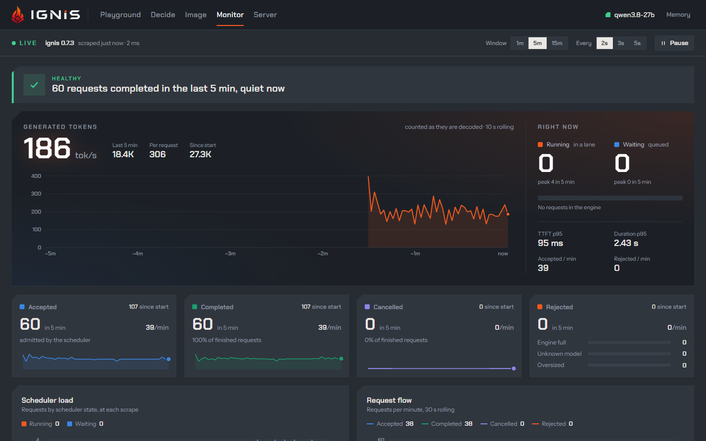

A serving engine is only as useful as the things around it: a way to try a
prompt, a way to see what the card is doing, a way to fetch the weights, a way to
change a setting. In ignis those are in the same `ignis-server` binary, started
with the same command. There is no second service to deploy for the UI, no
exporter to attach for metrics, and no script to download the model. Every
setting is one declaration that is a flag, an environment variable and a file
key at once.

## How it works

**The Playground.** A React app embedded into the server at build time and served
at `/ui/`: chat with tools and subagents, parallel sessions, image input, the
Image studio, the Decide tab, the Monitor and the Server view. Its sessions are
stored in the browser (IndexedDB), not on the server
([ADR 0026](../../adr/0026-playground-embedded-when-built.md)).

**Configuration.** Every option is declared once
([ADR 0046](../../adr/0046-one-declaration-per-config-field.md)) and is a flag
`--<group>-<field>`, an `IGNIS_<GROUP>_<FIELD>` variable and a key
`<group>.<field>` in YAML or JSON, with per-model values and a built-in profile
for the card. `GET /v1/config` shows the running configuration, and
`PATCH /v1/config` changes it, reloading the model only for a field that needs a
reload. The reference tables are generated from the code, and `cargo test` fails
if they drift from it.

**Counting.** `POST /v1/tokenize` counts a chat body's prompt as it would be
served, with its template, tools and thinking controls, without serving it.

**Metrics.** Prometheus has its own loopback listener, keyless and on by default,
and the Monitor reads the same set.

**Fetching.** Started with no artifact, a GPU build asks, downloads and verifies
the model ([ADR 0033](../../adr/0033-the-server-fetches-its-own-model.md)).

**Access.** `server.api_key` takes a key or `auto`, which generates one and
prints it once. `server.expose` opens a public quick-tunnel URL and always
requires a key ([ADR 0028](../../adr/0028-expose-modes-always-keyed.md)). The
`/v1` surface also documents itself at `/v1/openapi.json`
([ADR 0036](../../adr/0036-the-v1-surface-documents-itself.md)).

**Platforms.** A `v*` tag publishes a Windows `.zip`, a Linux `.tar.gz` and a
`linux/amd64` container image on ghcr.io, all compiled for `SM120a`.

## The numbers

There are no performance figures here. These are the defaults:

| Piece | Default | Reference |
|---|---|---|
| Playground | on, at `/ui/` | [`server.ui`](../reference/configuration.md#serverui) |
| Metrics listener | on, `127.0.0.1:9464`, no key | [`server.metrics_bind`](../reference/configuration.md#servermetrics_bind) |
| API key | unset: the API is open on localhost | [`server.api_key`](../reference/configuration.md#serverapi_key) |
| Public tunnel | off; when on, a key is always required | [`server.expose`](../reference/configuration.md#serverexpose) |
| Model download | a verified catalog entry, or a mirror | [`download.endpoint`](../reference/configuration.md#downloadendpoint) |

## See it, control it

- **Switch pieces off**: `--server-ui false`, `--server-metrics false`.
- **Print every field**: `ignis-server help --fields`; `GET /v1/config` for the
  running values.
- **Routes**: `/ui/`, `/v1/config`, `/v1/tokenize` and `/v1/openapi.json`.
- **CLI**: `ignis-server model download <id>`, and `ignis-bench` for
  measurements.
- **Metrics**: the full list is in the [metrics](../reference/metrics.md), and
  [Telemetry and metrics](../guides/telemetry.md) shows how to scrape and read
  them.
- **Playground**: the [Monitor](../playground/monitor.md) draws the metrics live
  and the [Server view](../playground/server.md) edits the configuration.

## Limits

- A binary built without the Playground's `web/dist` serves `/ui/` as a page that
  says how to build it ([The Playground](../playground/index.md)).
- The Prometheus listener is keyless and on loopback. Exposing it is the
  operator's act.
- A quick tunnel is a quick tunnel: the key is required, and `GET /v1/config`
  never shows it.
- ignis targets `SM120a`, the RTX 5090 and the RTX PRO 6000. It does not run on a
  DGX Spark ([DGX Spark](../guides/dgx-spark.md)).

## Read more

- [Playground, metrics, access](../configuration/access.md): the three switches in one place.
- [Counting a prompt](../api/count.md): `/v1/tokenize`.
- [Install](../start/install.md): the archives, the image and the checksums.
