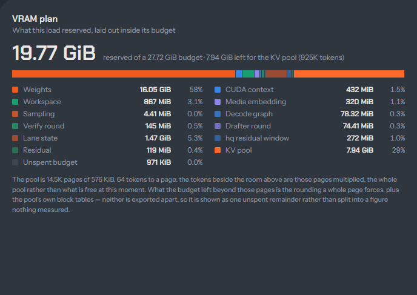

The usual way a serving process dies is a late allocation: a long prompt, a
ninth image, a burst of subagents, and some request at minute forty asks for
memory that is no longer there. ignis decides every byte at load. It reserves
the plan, prints it, and allocates nothing afterwards. In a replayed trace of
287 requests the process grew **6 MiB over 24.5 minutes**, where the run
before the plan grew 2,734 MiB in 14 minutes. A start that cannot hold its
minimum is refused, with the shortfall named.

## How it works

The load takes a budget: the device memory free at start minus a headroom
(1,536 MiB by default), or an explicit `vram.budget_bytes`. It carves that
budget in a fixed order into named lines: weights, workspace, lane state,
retained slots, media embedding, the CUDA context, the verify round, the
decode graph, the drafter round, residual and sampling buffers. Whatever is
left becomes the KV pool. Requests then allocate no device memory as they go,
and a retained-state capture that finds no slot is skipped, not served with a
fresh allocation ([ADR 0030](../../adr/0030-device-memory-reserved-at-load.md)).

The 27B adapts before it refuses. When the plan cannot hold what its profile
asks for in the memory the start finds free, the load lowers the values one at
a time and plans again: the drafter's head first, then the context in steps,
then the lanes. A value you name yourself never adapts, and `GET /v1/models`
lists every step in `adapted`
([when a profile does not fit](../concepts/profiles.md#when-a-profile-does-not-fit)).
A budget that cannot hold the minimum even then refuses the start: weights,
workspaces, every lane, every device retained slot, one sequence at the
maximum context and a page per retained slot. The refusal names the shortfall
and the flags that lower it. Pinned host memory is planned the same way and refused in GiB before
anything is pinned.

On Windows the plan matters twice. The display driver pages device memory out
to system RAM instead of failing an allocation, so unplanned growth is a silent
slowdown, not an error. At a 1 GiB headroom a browser drawing a page was enough
to page the model out. The default 1.5 GiB leaves it alone.

Version 0.7.3 handed memory back to the pool. The prefill attention no longer
expands prompt planes (up to 1.02 GB), and the 27B's 1.35 GB token embedding
lives in mapped host memory at about 1 us per prompt token. Both are in the plan,
so both show as a larger KV pool.

The budget, line by line, and why a refusal beats a run:
[The VRAM plan](../concepts/vram-plan.md).

## The numbers

| Figure | Measured on | Source |
|---|---|---|
| Growth **+2,734 MiB** in 14.1 min (55 requests) without the plan, **+6 MiB** in 24.5 min (287 requests) with it | RTX 5090, hq-e8-2b, DFlash2 with 7 drafts, vision on, 262,144 context, prompt reuse, 8 GiB KV-RAM; a replayed trace plus four parallel agent conversations of 50K-87K tokens | [VRAM budget, flat memory](../../findings/2026-09-18-vram-budget-flat-memory-gate.md) |
| Printed plan 28,558 MiB against 28,574 MiB dedicated in Task Manager after load: 16 MiB apart | same | same |
| 20 retained operations skipped for want of a slot rather than allocated | same | same |
| Prefill attention without prompt planes: 1,020,474,240 bytes less at 524K tokens | RTX 5090 | [Prefill attention without prompt planes](../../findings/2026-10-21-prefill-attention-without-prompt-planes.md) |
| Token embedding in host memory: 1.35 GB of VRAM for about 146K more KV tokens, at -0.15% to -0.7% cold prefill (14K-105K) | RTX 5090 | [Token embedding in host memory](../../findings/2026-10-21-token-embedding-in-host-memory.md) |
| The 5090 profile's 27B context 786,432 up to 917,504 with vision and DFlash2 on: KV pool 944,832 tokens; 950,272 refused by 59 MB, 1,048,576 refused 1.07 GB short | the plan raised until it refused | [Prefill attention without prompt planes](../../findings/2026-10-21-prefill-attention-without-prompt-planes.md) |
| At a 1 GiB headroom Flash-Next decoded at 4.6 tok/s and the 27B at about 40 tok/s while a browser drew; at 1.5 GiB neither moved | Windows, RTX 5090 | [Headroom and WDDM paging](../../findings/2026-10-09-vram-headroom-wddm-paging.md) |

:::note[Re-measure before you restate]
The 6 MiB run is a 262,144-context, 24.5-minute window, not the current
917,504 load. The method carries over (flat commit, a plan equal to the OS
figure), the number does not. The start budget also moves by about 100 MB with
what the desktop holds, so the 5090's context is what fits after the desktop.
:::

## See it, control it

- **The budget**: [`vram.headroom_bytes`](../reference/configuration.md#vramheadroom_bytes),
  [`vram.budget_bytes`](../reference/configuration.md#vrambudget_bytes) and
  [`vram.kv_pool_bytes`](../reference/configuration.md#vramkv_pool_bytes).
- **What the plan must hold**: [`model.max_context`](../reference/configuration.md#modelmax_context),
  [`model.prefill_chunk`](../reference/configuration.md#modelprefill_chunk) and
  [`model.host_margin_bytes`](../reference/configuration.md#modelhost_margin_bytes).
- **Oversubscription**: [`vram.allow_oversubscription`](../reference/configuration.md#vramallow_oversubscription),
  off by default, lets a plan exceed the device at your risk.
- **Log**: `ignis.runtime.vram_plan` prints every line (Flash-Next prints
  `ignis.runtime.flash_next_plan`); `ignis.runtime.vram_oversubscribed` and
  `ignis.runtime.flash_next_host_plan_refused` mark the refusals.
- **Metrics**: `ignis_vram_budget_bytes`, `ignis_vram_reserved_bytes` (by plan
  line) and `ignis_kv_pool_pages` ([metrics](../reference/metrics.md)); they
  read zero while no model is loaded.
- **Playground**: the [Monitor](../playground/monitor.md) draws the plan
  beside live use.

## Limits

- Pinned host memory (the KV-RAM arena, retained slots, Flash-Next's pool) is
  planned separately and shows as Windows "Shared GPU memory". A nonzero shared
  figure is not always paging.
- A refusal is a feature, but it is also a stop: the fix is a smaller context,
  fewer lanes or a smaller pool, named in the message.
- The plan is exact for ignis's own allocations. Other processes on the card
  (a browser, a game) still take what they take, which is what the headroom is
  for.

## Read more

- [The VRAM plan](../concepts/vram-plan.md): the budget, the lines, Windows and WDDM.
- [VRAM and the KV pool](../configuration/vram-and-kv-pool.md): sizing in practice.
- [Host RAM](../configuration/host-ram.md): the pinned side of the plan.
- [Context that follows the card](context-follows-the-card.md): what the plan allows.
