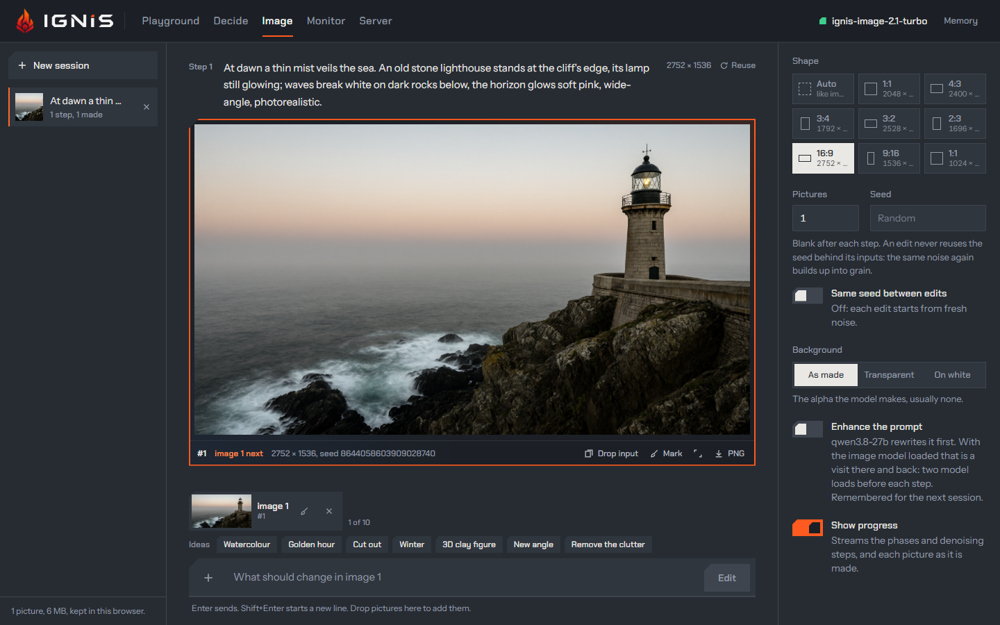

The card that runs your coding agent can also draw. ignis serves
Qwen-Image-2.1-Turbo on `POST /v1/images/generations` and
`POST /v1/images/edits`, the routes OpenAI's SDKs already speak, so a client that
makes pictures needs no second server. A 2048x2048 image takes **7.87 s end to
end** on the 5090, streamed through the Playground's own calls.

:::caution[Non-commercial licence]
The image weights are under the **Qwen Research License: non-commercial use
only**, with a "Built with Qwen" notice. Do not serve the image model in a
commercial product. The licence, and where the weights live, are on the
[Images](../api/images.md) page.
:::

## How it works

The image model makes pixels, so lanes, KV and generation caps do not apply to
it. It is reached by a switch from a text model: the card holds one model at a
time, so the 27B unloads and the image model loads (see
[Models that come and go](models-that-come-and-go.md)). The kernels are ignis's
own for the 5090: an FP8 W8A8 GEMM and an 8-bit attention for the 8-step
denoising loop, a VAE decode, and a condition encoder for edit inputs. An edit
takes one to ten PNG, JPEG or WebP images, and `stream: true` sends `progress`
events by phase (`enhancing`, `switching`, `loading`, `encoding`, `denoising`,
`decoding`).

After the weights, the VRAM that is left sets a **condition budget** of prompt
and input-image tokens; larger inputs are scaled down, not refused.
`prompt_enhancement` has the 27B rewrite the prompt first with Qwen's own system
prompts; with the 27B already loaded, the rewrite runs first and the server
switches once. The Playground's [Image studio](../playground/image-studio.md)
adds image sessions, marks drawn on a picture, and a `make_image` tool the chat
can call: it switches to the image model, makes the pictures and switches back.

## The numbers

| Figure | Measured on | Source |
|---|---|---|
| The denoising loop: 1.20 s at 1024x1024 (145-152 ms a step) and 6.11 s at 2048x2048 (747-802 ms a step); whole jobs 1.37 s and 6.79 s | in-process, 8 steps, RTX 5090 | [Image model on the 5090](../../findings/2026-10-14-image-model-on-the-5090.md) |
| Edit at 2048x2048: 7.62 s from one image, 10.72 s from four | in-process | same |
| The FP8 GEMM runs at 67-73% of the literature's FP8 bar (498-507 TFLOPS against 690-740); the 8-bit attention at 88-93% of its bar | RTX 5090 | same, and [Image model kernels](../../findings/2026-10-13-image-model-kernels-on-the-5090.md) |
| Served end to end, streamed: a 2048x2048 generation **7.87 s** (denoising 5.91 s of it); a 2-image edit **9.48 s** | the Playground's own calls, RTX 5090 | [Image serving spec, as built](../../specs/image-model/05-image-serving.md), the live run of 2026-10-14 |
| Switching 27B to the image model **10.0 s**, and back **11.3 s** | same run | same |

:::note[The ceiling is the GEMM, not the design]
The kernels target SM120a, and the 7.87 s is a 5090 figure. The GEMMs run at
about 70% of the literature's bar, so they set the ceiling. Same-seed edits
differ run to run in grain; read
[Image edit, same seed, grain](../../findings/2026-10-16-image-edit-same-seed-grain.md)
before promising reproducible edits.
:::

## See it, control it

- **Routes**: `POST /v1/images/generations` and `POST /v1/images/edits`, model id
  `ignis-image-2.1-turbo`, fetched with `ignis-server model download ignis-image-2.1-turbo`.
- **Sizes**: [`image.sizes`](../reference/configuration.md#imagesizes), every side a
  multiple of 32.
- **Queue and inputs**: [`image.queue_depth`](../reference/configuration.md#imagequeue_depth),
  [`image.max_n`](../reference/configuration.md#imagemax_n) and
  [`image.max_condition_images`](../reference/configuration.md#imagemax_condition_images).
- **Prompt rewrite**: [`image.prompt_enhancement`](../reference/configuration.md#imageprompt_enhancement).
- **Metrics**: `ignis_image_jobs_total` (by outcome), `ignis_image_images_total`,
  `ignis_image_job_duration_seconds`, `ignis_image_job_phase_seconds_total` and
  `ignis_image_queue_jobs`, in the [metrics](../reference/metrics.md).
- **Playground**: the [Image studio](../playground/image-studio.md); image
  sessions are stored in the browser.

## Limits

- One image job runs at a time; `n` images are made one after another.
- The response is an RGBA 8-bit PNG as `b64_json`. `response_format: url` and
  other `output_format` values are a `400`.
- The image model is never co-resident with a text model: a chat while it is
  loaded pays a switch of 10-11 s, and the switch drops the old load's retained
  state.

## Read more

- [Images](../api/images.md): routes, sizes, the licence, streaming and the condition budget.
- [Models that come and go](models-that-come-and-go.md): the switch an image job rides on.
- [Image studio](../playground/image-studio.md): the Playground's image sessions.
